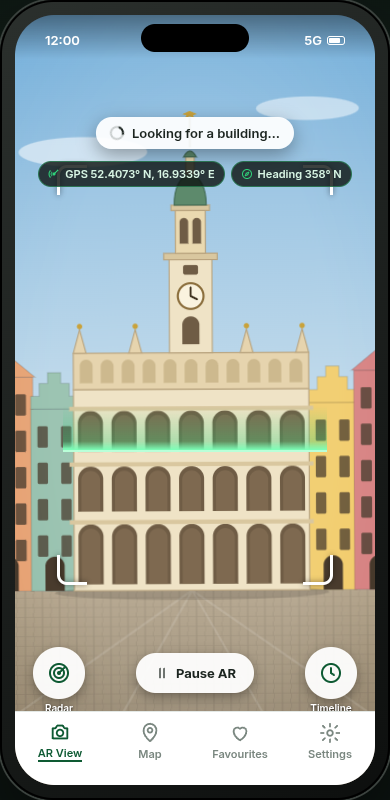
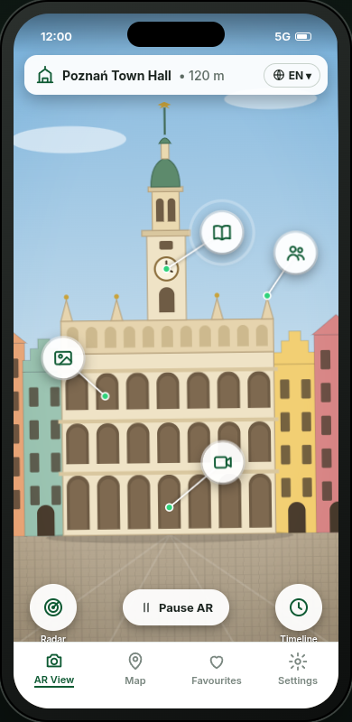
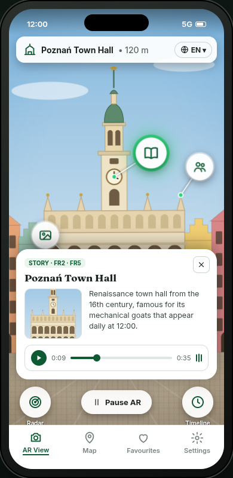
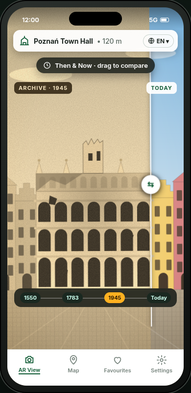
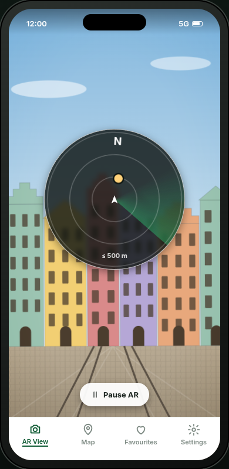
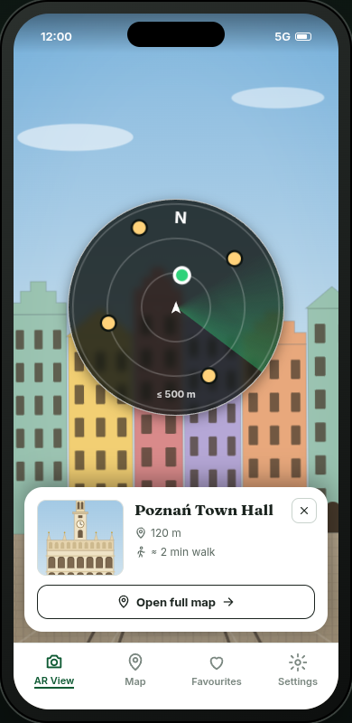
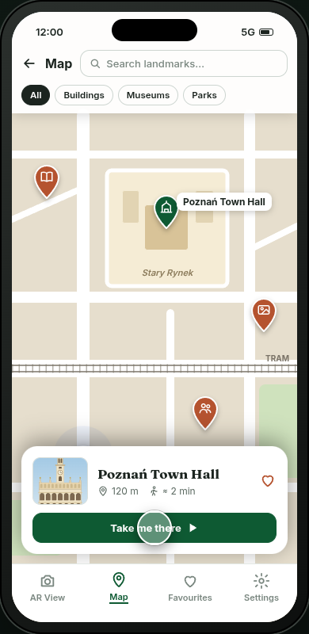
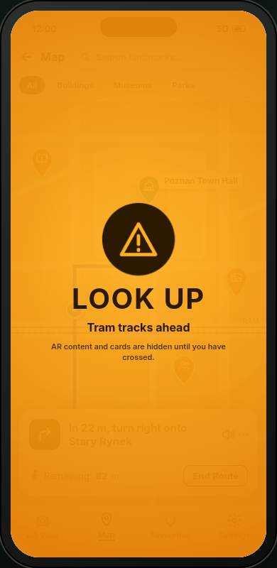
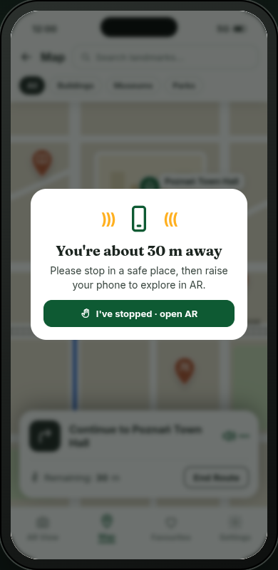
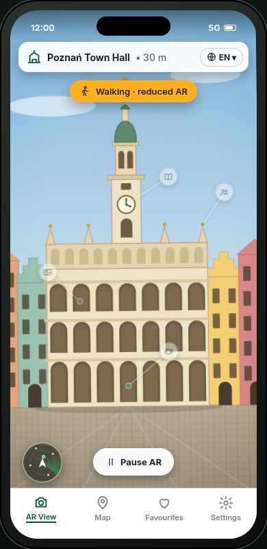

# AR Mobile Tourist Guide – concept animations

Two interactive HTML animations presenting the concept of a mobile augmented-reality tourist guide (Poznań Old Market Square). Authors: Zuzanna Musielak and Dominik Michalak, WSB Merito Poznań.

Each animation is a standalone HTML file – just open it in a browser (fonts are loaded from Google Fonts, so an internet connection is needed).

| File | Topic |
|---|---|
| [`animation-1-recognition.html`](animation-1-recognition.html) | Building recognition, AR bubbles, "Then & Now" overlay |
| [`animation-2-navigation.html`](animation-2-navigation.html) | Radar, map, navigation and safety features |

**Controls:** `Space` – pause/resume, `R` – restart, clicking a step in the side list jumps to that moment.

---

## Animation 1 – Recognition & AR bubbles (19.5 s)

### 1. Scanning (FR1, FR3)
After the camera is pointed at a building, a scanning frame appears. GPS position and compass heading narrow the search to nearby buildings.

### 2. Recognition and bubbles anchored to real details (FR1, FR2, NFR1)
Poznań Town Hall is recognized and its name and distance appear in the top bar. Info bubbles are attached to the clock tower, loggia, portal and attic.

### 3. Info card (FR2, FR5)
Tapping a bubble opens a card with a short fact, a photo and an audio story.

### 4. Then & Now (FR6, FR7)
An archival photo (1945) is aligned with the live view, and a slider reveals what was destroyed and rebuilt.

---

## Animation 2 – Radar, map & safety (22.5 s)

### 1. Nearby radar (FR3, FR4)
A small radar in the AR view shows landmarks within 500 m and rotates with the compass.

### 2. Landmark preview (FR4)
Tapping a dot opens a preview with photo, name, distance and estimated walking time.

### 3. Map and "Take me there"
Pins on a 2D map; choosing a destination draws a walking route with spoken directions.

### 4. "Look Up" warning (safety)
Near tram tracks the phone vibrates, shows a clear warning and temporarily hides AR content.

### 5. Stop to explore
About 30 m from the building the phone vibrates and asks the user to stop before raising the phone.

### 6. Reduced AR while walking
While walking, bubbles shrink to small transparent icons. Once the user stands still, full AR returns.

---

*The archival view is an illustrative reconstruction.*
